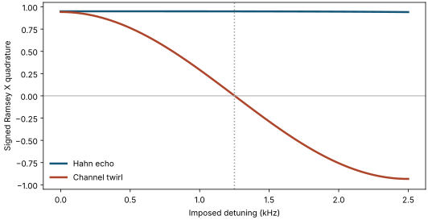

# From Hahn to Twirling in 60 Seconds

**What exactly are we averaging?** Start a spin along +X and let a static detuning give it a phase φ in time T. A Hahn echo reverses the sign of the detuning halfway through each shot. The spin accumulates +φ/2 and −φ/2 and refocuses. A channel twirl over {I, X} chooses one frame for the entire free interval and undoes the frame change before readout. The branches acquire +φ and −φ. Their mean transverse coherence is cos φ. At φ = π/2 both branches show full Ramsey fringes; the pooled fringe vanishes. Keep the frame bit and measure Y to see the opposite phases. At φ = π the pooled fringe returns with reversed sign.

### What the ion would measure

For T = 200 µs the null is at 1.25 kHz. Our finite-pulse simulation predicts 94.9% echo visibility and 0.25% pooled twirl visibility there. These are proposed clock-qubit measurements. The 50 kHz microwave Rabi frequency, +1% pulse amplitude error, 100 Hz rms shot-static jitter and 95% base visibility are illustrative. The Freiburg registry assigns the 114 µs Ramsey time to the stretch-state microwave transition. The spectroscopy laser is off in the proposed comparison. In the published experiment it was the loss of coherence through scattering that supplied the optical signal. [Freiburg parameters](https://single-25mg-plus-d679f9.pages.uni-freiburg.de/content/experiment/parameters.yaml) · [Clos et al., PRL 112, 113003 (2014), Fig. 2](https://doi.org/10.1103/PhysRevLett.112.113003).

### Three meanings of averaging

| Object | Physical implementation | What survives |
|---|---|---|
| Hamiltonian | Evolve successively in two toggling frames | At leading order, terms invariant under X conjugation. Refocusing of static Z detuning is exact. |
| Channel | Apply a randomly conjugated process and pool the outputs | The group-invariant part of the process. Here this is a dephasing channel with phase-flip probability sin²(φ/2). |
| State | Apply a random group element to the prepared state and average | The invariant components of the state. A bilateral rotation preserves singlet weight. |

An ensemble can implement a state twirl by spatial averaging in one acquisition. The distinction is between composing evolutions and averaging outcomes over an unresolved label. [Anwar et al., PRA 71, 032327 (2005)](https://doi.org/10.1103/PhysRevA.71.032327).

### Where the word came from

Hahn demonstrated spin echoes in 1950. Haeberlen and Waugh described cyclic control with average-Hamiltonian theory in 1968. In November 1995 Bennett and colleagues described random bilateral rotations for entanglement purification. The earliest explicit use of the technical noun **twirl** verified in this review is the first version of Bennett, DiVincenzo, Smolin and Wootters, dated **23 April 1996**. Oral coinage and the first appearance of the exact phrase “quantum twirl” remain undetermined. [Hahn](https://doi.org/10.1103/PhysRev.80.580) · [Haeberlen and Waugh](https://doi.org/10.1103/PhysRev.175.453) · [November 1995 preprint](https://arxiv.org/pdf/quant-ph/9511027) · [April 1996 preprint, v1](https://arxiv.org/pdf/quant-ph/9604024v1).

### What others have demonstrated

Single-NV sensing showed that randomizing decoupling-block phases suppresses spurious spectral lines. Superconducting transmons have combined dynamical decoupling and randomized compiling in one circuit. A single-ion photon-scattering experiment showed that recovering information from the photon can enable conditional spin correction. [Wang et al. (2019)](https://arxiv.org/abs/1903.01559) · [Evert et al., Fig. 7](https://arxiv.org/abs/2403.07836) · [Akerman et al. (2012)](https://doi.org/10.1103/PhysRevLett.109.103601).

### Run or extend the study

With Python 3, NumPy and Matplotlib installed, run `python echo_twirl.py` from this directory. It prints five detuning points, checks the ideal limit and regenerates the figure. The [perspective and experimental proposal](echo_twirl_perspective.md) gives the source-by-source platform comparison, readout statistics, and a follow-up test: add a transverse field and reverse the order of the two noncommuting evolutions. The order-sensitive signal is a prediction for a future experiment.
