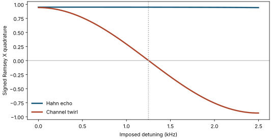

# From Hahn to Twirling · Team page

**Can one ion tell whether we applied two rotations in sequence or chose one rotation per shot?** We are developing a Ramsey experiment on the ²⁵Mg⁺ clock qubit to answer that question. The reviewed simulation and references are on `main`. The clock-qubit comparison and pulse-order test are proposed experiments. The optical spectra in [Clos et al., Fig. 2](https://doi.org/10.1103/PhysRevLett.112.113003) are the published starting point.

[Open work](https://github.com/uwarring82/from-hahn-to-twirling-in-60-seconds/issues) · [Changes under review](https://github.com/uwarring82/from-hahn-to-twirling-in-60-seconds/pulls) · [Experimental proposal](echo_twirl_perspective.md) · [Source checks](REVIEW.md)

## Before group meeting

Start the spin along +X. Choose the detuning so it would acquire a quarter turn during 200 µs. Sketch the final Bloch vector for each of three experiments: a midpoint Hahn pulse with frame closure, uninterrupted precession, and precession bracketed by X pulses. Which fringes would you see if you kept the last two records separate? Which fringe would survive if you pooled them?



The plot shows only X. At 1.25 kHz the pooled twirl crosses zero. The most informative next plot is **Y for each recorded branch**. Opposite conditional Y signals distinguish cancellation in the pooled readout from loss of coherence in each branch. Keep that distinction in mind when comparing this experiment with optical scattering.

## Reproduce the baseline

From the repository root, in a Python environment of your choice:

```sh
python -m pip install -r requirements.txt
python test_echo_twirl.py
python echo_twirl.py --outdir build/baseline
```

The eight checks cover the ideal limit, the reference model values, and pulse-order scaling. The last command writes a CSV, JSON parameter record and figure. With the default same-phase closing pulse, expect echo contrast **0.9493** and pooled contrast **0.0025** at 1.25 kHz. The predicted difference in bright-state probability is **0.474 ± 0.012** for 2,000 independent shots per arm (one standard error from projection noise). The [parameter record](echo_twirl.json) lists the assumptions. The 50 kHz microwave Rabi rate is illustrative. The [Freiburg registry](https://single-25mg-plus-d679f9.pages.uni-freiburg.de/content/experiment/parameters.yaml) lists Raman carrier rates and a separate stretch-state Ramsey measurement.

## Pick a contribution

| If you want to work on… | Start here | Bring back |
|---|---|---|
| Analysis · a first contribution | [Plot the two conditional fringes, issue #2](https://github.com/uwarring82/from-hahn-to-twirling-in-60-seconds/issues/2) | A plot of both Y branches, with the pooled signal and its uncertainty |
| Microwave control · experimental design | [Design the matched pulse sequences, issue #3](https://github.com/uwarring82/from-hahn-to-twirling-in-60-seconds/issues/3) | A pulse table, clock-state calibration sources, and a timing control for the extra π pulses |
| Theory or simulation · postdoc or student project | [Test the noncommuting extension, issue #4](https://github.com/uwarring82/from-hahn-to-twirling-in-60-seconds/issues/4) | An order-reversal plot and a check of the sign and factor of two between a single-order signal and the difference |
| Literature · journal club | [Read the verification table](REVIEW.md) | A primary-source figure or equation, its version, and the specific claim it supports or challenges |

Comment on an issue to take it up or find a partner. Put a first plot or derivation in the thread so colleagues can question assumptions early. For a change to the shared code or text, open a branch and link its pull request to the issue. Include the command, figure axes and units, and identify which inputs came from measurement. Use the repository’s **Watch** menu for project updates or **Subscribe** on an individual issue to follow one experiment.

## Three papers to read together

1. What rephases in Hahn’s original spin ensemble? [Hahn, *Spin Echoes* (1950)](https://doi.org/10.1103/PhysRev.80.580)
2. What object did the authors call a “twirl”? Look at §3.1, item 1, p. 22. [Bennett et al., April 1996 preprint](https://arxiv.org/pdf/quant-ph/9604024v1#page=22)
3. What does randomizing an echo-derived sequence change in a measured spectrum? [Wang et al., single-NV sensing (2019)](https://doi.org/10.1103/PhysRevLett.122.200403)

The [full perspective](echo_twirl_perspective.md) connects those questions to NMR, neutral atoms, photons, ions, diamond spins and superconducting circuits. The [bibliography](references.bib) contains the citation records.
